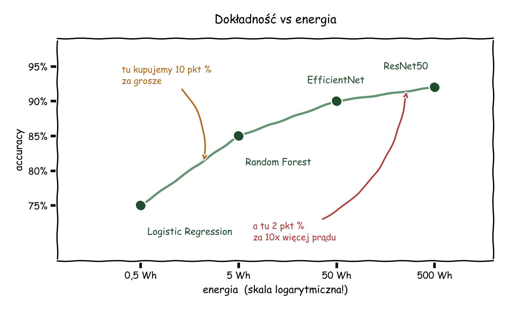

# Lekcja 01 — Wprowadzenie do Data Science i Machine Learning
## Odpowiedzi do zadań 8–20

---

## Zadanie 8 — Przykłady zastosowań DS dla ekologii

### 1. Prognoza produkcji energii z farmy wiatrowej

Operator sieci energetycznej musi z wyprzedzeniem wiedzieć, ile prądu dadzą turbiny. Jeśli nie wie, na wszelki wypadek trzyma w gotowości bloki węglowe, które pracują "na jałowym biegu" i emitują CO2 bez powodu.

Jest to zadanie regresji, a konkretnie prognozowanie szeregu czasowego. Potrzebne dane: prognozy pogody (prędkość i kierunek wiatru, ciśnienie, temperatura), historyczna produkcja każdej turbiny z osobna, parametry techniczne turbin oraz godzina i pora roku.

Korzyść: mniejsza rezerwa z elektrowni konwencjonalnych i mniej marnowanej energii odnawialnej, bo sieć potrafi się przygotować na nadwyżkę.

### 2. Wykrywanie wylesiania ze zdjęć satelitarnych

Nielegalne wycinki wykrywa się dziś najczęściej za późno, czasem po kilku miesiącach. Satelity fotografują ten sam teren co kilka dni, więc dane są dostępne od razu — brakuje tylko automatycznej analizy.

Typ zadania: segmentacja obrazu, czyli wykrywanie zmian pokrycia terenu między dwiema datami. Dane: zdjęcia Sentinel-2 lub Landsat z kolejnych tygodni, mapy obszarów chronionych, archiwalne zgłoszenia wycinek do uczenia modelu.

Korzyść: reakcja służb w ciągu dni zamiast miesięcy i ochrona lasów, które pochłaniają CO2.

### 3. Optymalizacja wywozu odpadów

Śmieciarki jeżdżą dziś najczęściej stałą trasą według harmonogramu, przez co opróżniają kontenery zapełnione w połowie i spalają paliwo na próżno.

Tu potrzebne są dwa elementy: regresja przewidująca zapełnienie kontenera za kilka dni oraz optymalizacja trasy na podstawie tej prognozy. Dane pochodzą z czujników poziomu w kontenerach, historii wywozów, kalendarza (święta i weekendy zmieniają wszystko), GPS pojazdów i mapy drogowej.

Korzyść: mniej przejechanych kilometrów, czyli mniej spalin i hałasu w mieście.

---

## Zadanie 9 — Projektowanie systemu rekomendacji

**Typ zadania ML.** To ranking — układamy listę filmów od najbardziej do najmniej trafnego dla danego użytkownika. Pod spodem działa zwykle model predykcyjny: regresja przewidująca ocenę albo klasyfikacja odpowiadająca na pytanie "czy obejrzy do końca".

**Jakie dane.** O użytkowniku: historia oglądania, oceny, język, kraj, urządzenie. O filmie: gatunek, rok produkcji, obsada, długość, opis, popularność. O interakcjach: co obejrzał, ile minut, co porzucił po pięciu minutach, w co kliknął i jednak nie obejrzał.

Interakcje są tu najcenniejsze. To, co ktoś faktycznie ogląda, mówi o nim znacznie więcej niż to, co deklaruje w ankiecie.

**Podejście do uczenia.** Supervised, ale hybrydowe — łączymy dwie metody, bo każda ma inną słabość:

- *Collaborative filtering* działa na zasadzie "użytkownicy podobni do Ciebie obejrzeli X". Daje najlepszą trafność, ale nie radzi sobie z nowymi filmami i nowymi użytkownikami, o których nie ma jeszcze żadnych danych (problem zimnego startu).
- *Content-based* porównuje cechy samych filmów. Jest mniej precyzyjne, ale ratuje sytuację przy zimnym starcie.

Stąd rozwiązanie: content-based dla nowości i nowych kont, collaborative dla całej reszty.

**Metryka.** Offline sprawdzamy NDCG@10 i Recall@10, czyli czy trafione pozycje wylądowały wysoko na liście, a nie gdzieś na 40. miejscu. Ale decydujący jest test A/B na żywym ruchu: czas oglądania, odsetek kliknięć i utrzymanie subskrypcji. Zdarza się, że model lepszy w metryce offline przegrywa w praktyce.

**Optymalizacja pod Green AI:**

1. Ranking dwuetapowy — tani model wybiera 500 kandydatów z całego katalogu, drogi model ocenia tylko te 500. Największa pojedyncza oszczędność w takim systemie.
2. Profile użytkowników i embeddingi filmów przeliczane raz na dobę wsadowo, a nie przy każdym wejściu na stronę.
3. Cache gotowej listy rekomendacji ważny kilka godzin. Katalog i tak nie zmienia się co minutę.
4. Retrening dopiero wtedy, gdy monitoring pokaże spadek jakości, a nie codziennie z przyzwyczajenia.
5. Trening w regionie chmury zasilanym zieloną energią — ten sam wynik przy kilkukrotnie mniejszej emisji.

---

## Zadanie 10 — Analiza trade-off: dokładność vs energia

### Efficiency ratio (accuracy / Wh)

| Model | Accuracy | Energia | Efficiency |
|---|---|---|---|
| Logistic Regression | 75% | 0,5 Wh | 150,0 |
| Random Forest | 85% | 5 Wh | 17,0 |
| EfficientNet | 90% | 50 Wh | 1,8 |
| ResNet50 | 92% | 500 Wh | 0,18 |

Różnica między skrajnymi modelami to ponad 800 razy — przy różnicy 17 punktów procentowych dokładności.

### Wykres



Oś energii jest logarytmiczna, inaczej trzy pierwsze modele zlałyby się w jeden punkt przy lewej krawędzi. Krzywa wypłaszcza się po prawej stronie i to jest tu najważniejsza obserwacja: ostatnie dwa punkty procentowe kosztują dziesięć razy więcej energii niż całe poprzednie piętnaście. Klasyczne prawo malejących przychodów.

### W jakich przypadkach który model

**Logistic Regression** — na start każdego projektu jako baseline, przy bardzo dużej skali i na tanich urządzeniach brzegowych. Trenuje się w minuty, więc można szybko sprawdzić, czy problem w ogóle da się rozwiązać.

**Random Forest** — dane tabelaryczne, średnia skala, sytuacje wymagające wyjaśnienia decyzji modelu.

**EfficientNet** — domyślny wybór produkcyjny. Najlepszy kompromis z całej czwórki.

**ResNet50** — tam, gdzie błąd kosztuje więcej niż prąd.

### Aplikacja mobilna → EfficientNet

Został zaprojektowany właśnie pod urządzenia o ograniczonych zasobach. Daje 90% przy dziesięciokrotnie mniejszym zużyciu niż ResNet50. Na telefonie liczy się bateria i czas odpowiedzi — dwa punkty procentowe nie są warte aplikacji, która rozładowuje telefon w godzinę i każe czekać na wynik.

### System bezpieczeństwa w elektrowni jądrowej → ResNet50

Tutaj proporcje się odwracają. 500 Wh kosztuje ułamek grosza, a przeoczona usterka to katastrofa. Urządzenie ma stałe zasilanie i nie działa na baterii, więc argument energetyczny praktycznie znika.

Co więcej, sam ResNet50 to za mało. W takim zastosowaniu dołożyłbym kilka modeli głosujących nad decyzją i obowiązkowe potwierdzenie przez operatora. Przy stawce "awaria reaktora" 92% dokładności nadal jest wynikiem słabym.

---

## Zadanie 11 — Design case: wykrywanie fraudu

### Typ zadania

Klasyfikacja binarna: fraud albo nie fraud. W praktyce model nie zwraca jednak decyzji, tylko prawdopodobieństwo, a próg odcięcia ustawia się według kosztów biznesowych i tego, ile alertów zespół jest w stanie obsłużyć.

### Supervised czy unsupervised?

Potrzebne są oba podejścia.

Podstawą jest **supervised** — mamy etykiety pochodzące z reklamacji i chargebacków, więc model może nauczyć się znanych schematów oszustw. Problem w tym, że uczy się wyłącznie przeszłości.

Dlatego dokładamy **unsupervised**, czyli detekcję anomalii. Wyłapuje ona transakcje nietypowe, nawet jeśli nigdy wcześniej nie widzieliśmy takiego schematu. Oszuści nieustannie zmieniają metody, więc sam model nadzorowany zawsze będzie o krok z tyłu.

### Wyzwania

| Wyzwanie | Jak sobie z nim poradzić |
|---|---|
| Imbalanced data (0,1% pozytywów) | Ważenie klas, undersampling większości, metryki inne niż accuracy |
| Opóźnione etykiety — chargeback przychodzi po tygodniach | Trening na danych sprzed kilku tygodni + osobny model anomalii na świeżych transakcjach |
| Concept drift — oszuści zmieniają taktykę | Monitoring jakości i retrening wyzwalany spadkiem |
| Limit czasu poniżej 100 ms | Lekki model, cechy przeliczone wcześniej |
| Koszt FP (zablokowany uczciwy klient) vs FN (strata pieniędzy) | Próg dobrany pod koszt wyrażony w złotówkach |

### Jak oceniać model

Accuracy odpada całkowicie. Model, który zawsze odpowiada "nie fraud", osiąga 99,9% dokładności i jest zupełnie bezużyteczny.

Sensowne są precision, recall i PR-AUC. Najbardziej praktyczna jest jednak metryka operacyjna: jaki recall osiągamy przy limicie alertów, które analitycy faktycznie przerobią w ciągu dnia. Próg wybieramy tam, gdzie koszt niesłusznie zablokowanych klientów równoważy straty z niewykrytych oszustw.

### Energooszczędność przy 10 mln transakcji dziennie

Przy takim wolumenie każdy milidżul przemnożony przez dziesięć milionów robi się realnym rachunkiem.

1. **Kaskada.** Proste reguły odsiewają około 99% transakcji oczywiście poprawnych (znany sklep, typowa kwota, znana lokalizacja). Model widzi tylko pozostały 1%, więc koszt spada stukrotnie.
2. **Lekki model.** Przy danych tabelarycznych gradient boosting daje jakość porównywalną z siecią głęboką za ułamek energii.
3. **Feature store.** Cechy klienta liczone raz i współdzielone między modelami, zamiast przeliczania ich przy każdej transakcji.
4. **Inference na CPU**, bez angażowania GPU.
5. **Retrening tygodniowy** albo wyzwalany driftem — nie codzienny.

---

## Zadanie 12 — Reguły vs ML w moderacji komentarzy

### Rozwiązanie oparte na regułach

Lista słów zabronionych, wyrażenia regularne łapiące też próby obejścia typu "k\*rwa", limity techniczne (zbyt dużo wielkich liter, linki, powtórzenia tej samej treści) oraz czarna lista użytkowników.

### Rozwiązanie oparte na ML

Klasyfikator tekstu uczony na oznaczonych komentarzach. W wersji taniej: TF-IDF plus regresja logistyczna. W wersji dokładnej: dostrojony model transformerowy.

### Porównanie

| Kryterium | Reguły | Machine Learning |
|---|---|---|
| Dokładność | 60–70% | 85–93% |
| Rozumienie kontekstu | brak — blokuje cytaty i zdania typu "nie bądź dupkiem" | dobre |
| Ironia, obraza bez wulgaryzmów | nie wykrywa | wykrywa częściowo |
| Utrzymanie | trudne, lista rośnie w nieskończoność | łatwiejsze, dodajemy przykłady zamiast reguł |
| Zużycie energii | praktycznie zerowe | trening plus koszt każdej predykcji |
| Koszt wdrożenia | niski | wyższy: dane, etykietowanie, infrastruktura |
| Wyjaśnialność | pełna, widać którą regułę naruszono | ograniczona |
| Reakcja na nowe zjawisko | natychmiastowa, dopisujemy regułę | wymaga zebrania danych i retreningu |

### Która metoda jest lepsza

ML wygrywa na dokładności, ale samodzielnie nie jest najlepszym wyborem. Reguły są bezkonkurencyjne na przypadkach oczywistych i praktycznie nic nie kosztują, a dodatkowo pozwalają zareagować na nową falę spamu w pięć minut, czego model nie potrafi.

### Rozwiązanie hybrydowe

Najlepiej połączyć oba podejścia warstwowo:

1. **Reguły** blokują natychmiast oczywiste wulgaryzmy i spam, bez uruchamiania modelu. Odsiewa to sporą część ruchu za darmo.
2. **Lekki model ML** ocenia resztę i zwraca prawdopodobieństwo toksyczności.
3. **Człowiek** dostaje przypadki niepewne, czyli wynik w okolicach 0,4–0,6. Jego decyzje wracają jako nowe dane treningowe, więc model stopniowo się poprawia.

Taki układ daje dokładność zbliżoną do czystego ML przy znacznie niższym zużyciu energii i zostawia kontrolę człowiekowi dokładnie tam, gdzie jest potrzebna.

---

## Zadanie 13 — Design end-to-end: Smart City Traffic

### Jakie dane są potrzebne

Czujniki ruchu: pętle indukcyjne i kamery dające liczbę pojazdów oraz długość kolejek. Dane GPS z nawigacji i z floty komunikacji miejskiej, z których wynikają rzeczywiste prędkości i czasy przejazdu. Aktualny stan i program sygnalizacji. Pogoda, kalendarz wydarzeń (mecze, remonty, święta) i zgłoszenia zdarzeń drogowych. Mapa sieci z geometrią skrzyżowań. Do oceny efektu przydadzą się też pomiary jakości powietrza.

### Typy zadań ML

Takich systemów nie da się zbudować jednym modelem. Potrzeba przynajmniej pięciu:

1. **Detekcja obiektów** — zliczanie pojazdów, pieszych i rowerzystów na obrazie z kamer.
2. **Regresja / szeregi czasowe** — prognoza natężenia ruchu na najbliższe 15–60 minut.
3. **Klasyfikacja** — wykrywanie zdarzeń: wypadek, blokada pasa, nadjeżdżający pojazd uprzywilejowany.
4. **Reinforcement learning** — sterowanie fazami świateł. To zadanie główne, reszta jest dla niego zapleczem.
5. **Klasteryzacja** — grupowanie typowych wzorców dni i skrzyżowań, żeby dla każdego typu stosować inną strategię.

### Podejścia do uczenia

Detekcja i prognozy to klasyczny supervised. Sterowanie to RL, uczony najpierw w symulatorze ruchu (np. SUMO), bo eksperymentowanie na żywym mieście nie wchodzi w grę. Dopiero wytrenowany agent trafia na ulicę, i to z twardymi ograniczeniami: minimalny czas zielonego, maksymalny czas czerwonego, gwarantowana faza dla pieszych.

### Jak zmierzyć sukces

Metryki techniczne: średni czas przejazdu korytarzem, liczba zatrzymań na trasie, długość kolejek.

Metryki miejskie, czyli te, które naprawdę interesują mieszkańców i radnych: emisja CO2 i NOx, zużycie paliwa, czas przejazdu karetek i straży pożarnej, liczba kolizji, czas oczekiwania pieszych na przejściu.

Metodologia: test A/B. Skrzyżowania z systemem porównujemy z porównywalnymi skrzyżowaniami bez systemu w tym samym okresie. Porównanie "rok do roku" byłoby bezwartościowe, bo ruch zmienia się z wielu innych powodów.

### Jak zapewnić Green AI

Agenta RL trenujemy w symulatorze, co jest tanie i nie wymaga, by prawdziwe samochody paliły paliwo na potrzeby eksperymentu.

Obraz z kamer przetwarzamy lokalnie na sterowniku, a do centrum wysyłamy same liczby zamiast strumienia wideo. To największa oszczędność w całym systemie — transmisja i analiza wideo w chmurze kosztują wielokrotnie więcej niż analiza na miejscu.

Do tego małe, skwantyzowane modele wizyjne na urządzeniach brzegowych i retrening sezonowy zamiast ciągłego.

Osobno warto policzyć bilans netto: system zużywa energię, ale oszczędza paliwo tysięcy samochodów dziennie. Ten rachunek jest głównym uzasadnieniem projektu i powinien być regularnie raportowany, a nie zakładany.

### Ryzyka i wyzwania etyczne

**Prywatność.** Kamery rejestrują ludzi i tablice rejestracyjne. Rozwiązanie: anonimizacja bezpośrednio na urządzeniu, zapisywanie wyłącznie zliczeń, zero przechowywanych nagrań.

**Sprawiedliwość.** Optymalizacja "przepustowości" potrafi po cichu faworyzować arterie przelotowe kosztem osiedli, a samochody kosztem pieszych. Jeśli w funkcji celu nie ma czasu oczekiwania pieszych, system nauczy się go ignorować. Trzeba go tam wpisać wprost.

**Bezpieczeństwo.** Przy awarii albo nietypowym zachowaniu agenta system musi automatycznie wrócić do stałego, sprawdzonego programu.

**Cyberbezpieczeństwo.** Sygnalizacja świetlna to infrastruktura krytyczna i będzie celem ataków.

**Odpowiedzialność.** Kto odpowiada za wypadek na skrzyżowaniu sterowanym automatycznie? To pytanie miasto musi rozstrzygnąć przed wdrożeniem, a nie po pierwszym zdarzeniu.

---

## Zadanie 14 — Semi-Supervised Strategy

### Co zrobić z 1 000 opisanych zdjęć

Najpierw podział: około 700 na trening, 150 na walidację, 150 na test odłożony do samego końca. Ten ostatni zbiór musi pozostać nietknięty przez cały projekt, inaczej nie da się uczciwie ocenić, czy semi-supervised cokolwiek dał.

Na tych 700 zdjęciach dostrajamy gotowy model (transfer learning z ResNet lub CLIP), zamiast trenować cokolwiek od zera. Przy tysiącu przykładów trening od zera nie ma żadnych szans.

### Co zrobić z 99 000 nieopisanych zdjęć

Są trzy techniki, które warto połączyć:

**Self-supervised pretraining** (SimCLR, DINO). Model uczy się, że dwa różne wycinki tego samego zdjęcia przedstawiają ten sam obiekt. Nie potrzebuje do tego żadnych etykiet, a uczy się reprezentacji, w których buty, koszule i spodnie są już od siebie oddzielone.

**Pseudo-labeling.** Model bazowy etykietuje nieopisane zdjęcia, my bierzemy tylko te predykcje, których jest pewien powyżej 0,95, dokładamy je do zbioru treningowego i powtarzamy cykl dwa–trzy razy. Próg jest tu kluczowy: zbyt niski sprawia, że model utrwala własne błędy.

**Active learning.** Wybieramy 500 zdjęć, co do których model jest najbardziej niepewny, i to właśnie je dajemy człowiekowi do opisania. Jedna taka etykieta jest warta znacznie więcej niż etykieta losowego zdjęcia.

### Proponowana kolejność działań

1. DINO na wszystkich 100 000 zdjęć, bez etykiet — otrzymujemy dobry backbone.
2. Fine-tuning na 700 opisanych zdjęciach.
3. Pseudo-labeling z wysokim progiem pewności, dwie–trzy iteracje.
4. Active learning: 500 najtrudniejszych zdjęć do opisania przez człowieka.
5. Finalny fine-tuning na powiększonym zbiorze.

### Porównanie z baseline

Ten sam odłożony zbiór testowy i ta sama metryka. Baseline to fine-tuning wyłącznie na 700 etykietach.

Patrzymy na F1 makro, a nie na accuracy — klasy rzadkie są tu najtrudniejsze i to właśnie na nich widać, czy cała ta konstrukcja ma sens. Accuracy łatwo ukryje, że model nauczył się trzech najpopularniejszych kategorii i ignoruje resztę.

### Szacunek oszczędności

Względem opisania wszystkich 100 000 zdjęć oszczędzamy przede wszystkim pracę ludzką: 99 000 zdjęć po około 10 sekund to mniej więcej 275 roboczogodzin plus koszt kontroli jakości etykiet.

Warto jednak zaznaczyć, że samo self-supervised pretraining zużywa więcej energii niż zwykły fine-tuning — mówimy o dziesiątkach godzin GPU. Jest tańsze niż trening dużej sieci od zera, ale nie jest darmowe.

Główny zysk leży więc w czasie i koszcie etykietowania, a nie w kilowatogodzinach. ROI trzeba liczyć na koszcie całkowitym: ludzie plus sprzęt plus energia.

---

## Zadanie 15 — Reinforcement Learning Design

### Opis problemu

**Agent** to system sterowania budynkiem. Kontroluje ogrzewanie (temperaturę zadaną w strefach), klimatyzację, wentylację, oświetlenie oraz rolety.

**Environment** to budynek wraz z pogodą na zewnątrz i mieszkańcami w środku.

**Stan** obejmuje: temperaturę w każdej strefie i na zewnątrz, wilgotność, stężenie CO2, obecność i liczbę osób, porę dnia, dzień tygodnia i porę roku, prognozę pogody wraz z nasłonecznieniem, aktualną cenę energii oraz stan urządzeń.

**Akcje:** zmiana temperatury zadanej o ±0,5 °C, włączenie, wyłączenie lub zmiana biegu wentylacji, ściemnienie albo wyłączenie oświetlenia, otwarcie lub zamknięcie rolet. Rolety to często najbardziej opłacalna akcja — zimą wpuszczają darmowe ciepło, latem chronią przed przegrzaniem.

### Funkcja nagrody

```
r = - (a * zużyta_energia_kWh * cena_energii)
    - (b * dyskomfort)
    - (c * liczba_przełączeń)

dyskomfort = odchylenie temperatury od strefy komfortu 20-24 °C,
             liczone TYLKO wtedy, gdy w pomieszczeniu są ludzie
             + dodatkowa kara, gdy stężenie CO2 przekroczy 1000 ppm
```

Trzeci składnik, kara za częste przełączanie, zapobiega sytuacji, w której agent odkrywa, że szarpanie urządzeniami co 30 sekund minimalnie obniża rachunek — i niszczy przy tym sprzęt.

Wagi a, b i c ustala właściciel budynku. To w nich zapisana jest odpowiedź na pytanie, ile warty jest komfort w przeliczeniu na kilowatogodziny, i to jest decyzja biznesowa, nie techniczna.

### Pętla agent–environment

```
        +--------------------+
        |       AGENT        |
        | polityka sterowania|
        +---+------------+---+
            |            ^
   akcja a  |            |  stan s + nagroda r
  (grzej,   |            |  (temperatura, CO2,
   przyciem,|            |   zużycie, obecność)
   roleta)  v            |
        +---+------------+---+
        |    ENVIRONMENT     |
        | budynek + pogoda   |
        |    + mieszkańcy    |
        +--------------------+
```

### Dlaczego nie supervised learning

Supervised wymaga poprawnych odpowiedzi do nauczenia. Tutaj ich po prostu nie ma — nikt nie wie, jaka akcja jest w danym momencie optymalna. Znamy wyłącznie skutki decyzji, które ktoś już podjął.

W najlepszym razie model nadzorowany nauczyłby się naśladować obecnego operatora albo obecny harmonogram, czyli odtworzyłby istniejącą nieefektywność. RL może znaleźć strategię lepszą niż wszystko, co znajduje się w danych historycznych, i to jest jego główna przewaga.

Drugi powód jest jeszcze ważniejszy. Decyzje są sekwencyjne i mają skutki odroczone: podgrzanie budynku teraz wpływa na temperaturę za dwie godziny. Liczy się suma nagród w czasie, a nie trafność pojedynczej decyzji. Supervised uczy się punktowo, RL optymalizuje całą trajektorię — i tylko on potrafi nauczyć się strategii typu "rozgrzej budynek, gdy prąd jest tani, i wyłącz ogrzewanie w szczycie cenowym".

**Uwaga praktyczna:** agenta uczymy najpierw w symulatorze, na przykład EnergyPlus. Faza eksploracji w RL polega na próbowaniu losowych akcji, a w prawdziwym budynku oznaczałoby to zmarzniętych albo ugotowanych ludzi. Na wdrożeniu nakładamy twarde limity, których agent nie może przekroczyć bez względu na to, czego się nauczył.

---

## Zadanie 16 — Multi-Model System Design

### Komponenty systemu

| # | Zadanie | Typ ML | Podejście | Energochłonność |
|---|---|---|---|---|
| 1 | Klasyfikacja zdjęć produktów | Klasyfikacja obrazów | Supervised, transfer learning | Średnia |
| 2 | Generowanie opisów | Generowanie tekstu | Gotowy LLM + prompt lub LoRA | Wysoka |
| 3 | Rekomendacje | Ranking | Supervised + collaborative filtering | Średnia, ale ogromna skala |
| 4 | Wykrywanie fałszywych recenzji | Klasyfikacja binarna + anomalie | Supervised + unsupervised | Niska |

### Architektura

```
      zdjęcie produktu
             |
             v
  [1] KLASYFIKATOR OBRAZÓW ---> kategoria + atrybuty
             |                           |
             v                           v
   embedding produktu  --------> [2] GENERATOR OPISÓW
             |                           |
             |                           v
             |                   opis zapisany w bazie
             v                      (liczony RAZ)
   +--------------------+
   |   FEATURE STORE    | <--- historia zakupów, kliknięcia
   +---------+----------+
             |
             v
   [3] REKOMENDACJE <--- filtr jakości <--- [4] DETEKTOR FAŁSZYWYCH RECENZJI
             |
             v
    lista dla użytkownika
```

### Jak komponenty ze sobą współpracują

Spina je wspólna warstwa danych: feature store i wspólne embeddingi produktów, liczone raz i wykorzystywane przez wszystkie cztery modele. Bez tego każdy komponent przeliczałby to samo osobno.

Klasyfikator zdjęć nadaje produktowi kategorię i atrybuty, które są wejściem zarówno dla generatora opisów, jak i dla rekomendacji content-based. Dzięki temu nowy produkt dostaje sensowne rekomendacje od pierwszego dnia, zanim ktokolwiek go kupi.

Detektor fałszywych recenzji obniża wiarygodność oceny produktu, a ta ocena jest cechą w modelu rankingowym. Efekt: system nie promuje produktów z kupionymi opiniami.

### Co zużywa najwięcej

Generator opisów jest najdroższy w przeliczeniu na jedno wywołanie — to duży model językowy.

Rekomendacje są tanie pojedynczo, ale przy milionach zapytań dziennie sumarycznie potrafią kosztować więcej niż LLM. Łatwo to przeoczyć, patrząc tylko na koszt pojedynczej operacji.

### Plan optymalizacji

1. **Nie trenować LLM od zera.** Gotowy model z dobrym promptem albo lekkim dostrojeniem (LoRA) to różnica rzędu tysięcy razy w zużyciu energii.
2. **Opisy generować raz i zapisywać.** Opis produktu nie zmienia się co sekundę, więc nie ma żadnego powodu, by liczyć go przy każdym wyświetleniu strony. To najprostsza i największa oszczędność w całym systemie.
3. **Wspólny backbone wizyjny** dla klasyfikacji i wyszukiwania po obrazie, zamiast dwóch osobnych sieci robiących w gruncie rzeczy to samo.
4. **Destylacja** dużego modelu do mniejszego na potrzeby produkcji.
5. **Dwuetapowe rekomendacje** plus cache dla najpopularniejszych zapytań.
6. **Autoskalowanie GPU**, żeby karty nie stały włączone bez pracy. W praktyce to jedno z najczęstszych i najdroższych marnotrawstw.
7. **Pomiar kWh osobno dla każdego komponentu.** Czego nie mierzymy, tego nie zoptymalizujemy — i zwykle okazuje się, że koszt leży gdzie indziej, niż zakładaliśmy.

---

## Zadanie 17 — Benchmark: Energy vs Accuracy (klasyfikacja tekstu)

Wartości poniżej to rzędy wielkości dla typowego zbioru kilkudziesięciu tysięcy dokumentów, zebrane na podstawie publikowanych benchmarków.

| Podejście | Accuracy | Energia treningu | Energia predykcji | Czas treningu | Czas predykcji | Wdrożenie |
|---|---|---|---|---|---|---|
| Keyword matching | 60–70% | brak treningu | ~0 | godziny pracy człowieka | < 1 ms | bardzo łatwe |
| Logistic Regression (TF-IDF) | 82–88% | ~0,01 kWh | ~0,001 Wh | minuty na CPU | < 1 ms | łatwe |
| Random Forest | 83–88% | ~0,05 kWh | ~0,01 Wh | minuty–godziny na CPU | 1–5 ms | łatwe |
| LSTM | 86–90% | ~1–5 kWh | ~0,1 Wh | godziny na GPU | ~10 ms | średnie |
| BERT (fine-tuning) | 91–94% | ~5–20 kWh | ~0,5–1 Wh | godziny na GPU | 20–50 ms na GPU | trudniejsze |

Jedno zastrzeżenie do ostatniego wiersza: podana energia dotyczy wyłącznie dostrojenia modelu. Wstępne wytrenowanie BERT-a to setki, a dla większych modeli tysiące kilowatogodzin — ale ten koszt poniósł raz autor modelu, a korzystają z niego wszyscy. Na tym właśnie polega siła transfer learningu jako praktyki Green AI.

### Wykres accuracy vs energia

```
accuracy
  93% |                                         BERT ●
  88% |                RF ●   ● LSTM
  85% |     LogReg ●
  65% | Keyword ●
      +---------------------------------------------------
        ~0      0,01      0,05      1-5        5-20    kWh
                     (skala logarytmiczna)
```

Przejście z 65% na 86% kosztuje grosze. Przejście z 86% na 93% kosztuje sto do tysiąca razy więcej.

### Rekomendacje

| Scenariusz | Wybór |
|---|---|
| Moderacja treści, miliony tekstów dziennie | Reguły + Logistic Regression |
| Analiza sentymentu w raportach, mały wolumen | BERT — jakość ma tu realną wartość |
| Urządzenie offline albo telefon | Logistic Regression lub destylowany DistilBERT |
| Dane tabelaryczne, gdzie tekst to jedna z cech | Random Forest albo gradient boosting |
| Pierwszy prototyp dowolnego projektu | Logistic Regression jako baseline |

### Analiza Green AI efficiency

W przeliczeniu na accuracy na kilowatogodzinę regresja logistyczna wygrywa z BERT-em o kilka rzędów wielkości, tracąc przy tym 5–8 punktów procentowych dokładności.

Wniosek praktyczny: zaczynamy od najprostszego modelu i przechodzimy do droższego dopiero wtedy, gdy różnica w jakości przekłada się na mierzalną wartość biznesową. Bardzo często okazuje się, że nie przekłada się wcale — a baseline i tak jest potrzebny, żeby w ogóle móc to stwierdzić.

---

## Zadanie 18 — Ethical AI + Green AI (diagnostyka RTG)

### Co, jeśli model się myli

Błędy w diagnostyce nie są równorzędne. Fałszywie negatywny, czyli przeoczona choroba, jest znacznie groźniejszy niż fałszywie pozytywny, który kończy się dodatkowym badaniem. Próg decyzyjny ustawiamy więc wyraźnie w stronę wysokiej czułości, godząc się na więcej fałszywych alarmów.

**Odpowiedzialność.** System musi być narzędziem wspierającym radiologa, a nie podmiotem podejmującym decyzję. Odpowiedzialność za diagnozę zostaje przy lekarzu i placówce. Producent odpowiada za jakość modelu, walidację kliniczną i rzetelne udokumentowanie ograniczeń — w tym tego, na jakiej populacji model był uczony i gdzie przestaje działać.

W Unii Europejskiej taki system jest jednocześnie wyrobem medycznym i, zgodnie z AI Act, systemem wysokiego ryzyka. Oznacza to obowiązkowy nadzór człowieka, logowanie decyzji i możliwość odwołania się od wyniku.

### Czy 99% jest warte stukrotnie większej energii niż 97%

W tym konkretnym przypadku tak, ale samo pytanie jest źle postawione.

Dwa punkty procentowe w diagnostyce to konkretni ludzie. Przy 100 000 badań rocznie mówimy o 2 000 osób, które dostaną inną diagnozę. Jednocześnie energia potrzebna na jedną analizę AI jest znikoma w porównaniu z energią samego aparatu RTG, nie mówiąc o dojeździe pacjenta do szpitala.

Zamiast godzić się na stukrotny koszt, najpierw należy go zbić metodami, które nic nie kosztują w jakości:

- kaskada: tani model odsiewa zdjęcia jednoznacznie prawidłowe, drogi ocenia tylko resztę,
- kwantyzacja i destylacja modelu produkcyjnego,
- jedno dobrze zaplanowane trenowanie zamiast setek przypadkowych eksperymentów — w praktyce to tutaj ucieka najwięcej energii w całym projekcie.

### Fairness

Model trzeba oceniać osobno dla każdej podgrupy: płeć, wiek, pochodzenie, typ aparatu, szpital. Uśredniona dokładność potrafi skutecznie ukryć fakt, że dla jednej grupy model działa wyraźnie gorzej.

Klasyczna pułapka w tej dziedzinie: model uczy się rozpoznawać szpital, a nie chorobę. Wystarczy, że w jednej placówce było więcej przypadków chorych, a na kliszach widnieje charakterystyczne oznaczenie albo zdjęcia mają inną charakterystykę aparatu. Model osiąga świetny wynik na zbiorze testowym i kompletnie zawodzi w nowym miejscu.

Zabezpieczenia: zróżnicowany zbiór treningowy, usuwanie oznaczeń ze zdjęć, audyt wyników w podgrupach i obowiązkowa walidacja zewnętrzna na danych z innej placówki.

### Privacy

Anonimizacja plików DICOM obejmuje nie tylko metadane pacjenta, ale też napisy wypalone bezpośrednio w obrazie, o których łatwo zapomnieć. Do tego świadoma zgoda na wykorzystanie danych do trenowania, przetwarzanie lokalne zamiast wysyłania zdjęć do chmury, kontrola dostępu i logi.

Najciekawszą opcją jest federated learning: model jedzie do danych, a dane nigdy nie opuszczają szpitala. Pozwala to uczyć na wielu placówkach bez centralnego zbierania wrażliwych obrazów, co dodatkowo poprawia fairness.

### Green AI

Transfer learning zamiast treningu od zera, ograniczenie liczby eksperymentów dzięki przemyślanemu planowi, predykcja na CPU lub zoptymalizowanym akceleratorze, dostawca chmury korzystający z czystej energii oraz pomiar i raportowanie zużycia.

### Framework decyzyjny

Kiedy trade-off accuracy vs energia jest akceptowalny? Cztery pytania, zadawane w tej kolejności:

1. **Jaka jest cena błędu dla człowieka?** Zdrowie i życie — jakość wygrywa bez dyskusji. Rekomendacja filmu — energia wygrywa.
2. **Czy różnica w jakości jest statystycznie istotna na niezależnym zbiorze testowym?** Jeśli 99% i 97% mieszczą się w przedziale niepewności, wybieramy tańszy model. Zaskakująco często właśnie tak jest.
3. **Czy tę jakość da się osiągnąć taniej w inny sposób?** Kaskada, destylacja, lepsze dane, dokładniejsze etykiety. Zwykle da się.
4. **Jaki jest pełny bilans środowiskowy w porównaniu z alternatywą?** Dokładniejszy model potrafi wyeliminować niepotrzebne powtórne badania i dojazdy, więc zużywa więcej prądu, a mniej zasobów ogółem.

Reguła nadrzędna: im wyższa stawka ludzka, tym mniej waży energia. Ale zawsze najpierw wyczerpujemy optymalizacje, które nie kosztują nic w jakości.

---

## Zadanie 19 — Data Science for Climate Change

### Wybrany problem

Krótkoterminowa prognoza ryzyka pożaru lasu: przewidywanie na 1–7 dni do przodu, w siatce 1 × 1 km. Służby dostają mapę ryzyka i mogą rozmieścić patrole oraz sprzęt tam, gdzie zagrożenie jest największe, zamiast reagować dopiero na zgłoszenie.

Wybrałem ten problem, bo ma trzy cechy rzadko występujące razem: dane są darmowe i publiczne, efekt da się policzyć w tonach CO2, a model nie wymaga dużej mocy obliczeniowej.

### Typ zadania i podejście

Klasyfikacja: czy w danym kwadracie i dniu wybuchnie pożar. Równie dobrze można to ująć jako regresję indeksu ryzyka, co jest wygodniejsze w prezentacji — mapa z ciągłą skalą czyta się lepiej niż mapa zero-jedynkowa.

Uczenie nadzorowane. Dane są głównie tabelaryczne i przestrzenne, więc podstawą jest gradient boosting (XGBoost, LightGBM), ewentualnie wzbogacony o cechy wyliczone ze zdjęć satelitarnych. Sieć głęboka nie jest tu potrzebna i tylko podniosłaby koszt.

Główna trudność to silnie niezbalansowane dane — pożary są na szczęście rzadkie. Stosujemy te same techniki co przy wykrywaniu fraudu.

### Dane i źródła

| Dane | Źródło |
|---|---|
| Historia pożarów | NASA FIRMS, dane PSP i Lasów Państwowych |
| Pogoda i prognozy | ERA5 (Copernicus), IMGW |
| Wskaźniki roślinności NDVI, wilgotność | Sentinel-2, Sentinel-3 |
| Typ lasu, wiek drzewostanu | Bank Danych o Lasach |
| Ukształtowanie terenu | numeryczny model terenu |
| Bliskość dróg i zabudowy | OpenStreetMap |

Niemal wszystkie źródła są otwarte i bezpłatne, co radykalnie poprawia opłacalność projektu. Ostatnia pozycja jest ważniejsza, niż się wydaje — zdecydowana większość pożarów lasów ma przyczynę ludzką, więc odległość od dróg i zabudowy bywa silniejszym predyktorem niż sama pogoda.

### Pomiar efektu

Mierzymy: odsetek pożarów, które faktycznie wystąpiły w kwadratach oznaczonych jako wysokie ryzyko; średni czas od zapłonu do podjęcia akcji gaśniczej; spaloną powierzchnię w hektarach.

Przeliczenie na CO2: jeden hektar spalonego lasu to kilkadziesiąt ton uwolnionego dwutlenku węgla plus utrata zdolności pochłaniania na kolejne lata. Oszczędzone tony to uniknięte hektary pomnożone przez ten współczynnik.

Trzeba przy tym pamiętać, że atrybucja jest trudna. Susza albo deszczowe lato wpłyną na statystyki znacznie bardziej niż jakikolwiek model, więc porównanie "rok do roku" niczego nie dowodzi. Potrzebny jest region kontrolny bez systemu, obserwowany w tym samym sezonie.

### Green AI samego projektu

Dane tabelaryczne i gradient boosting oznaczają godziny pracy CPU, bez GPU. Predykcja liczona raz dziennie dla całej siatki w jednym przebiegu wsadowym, a nie na żądanie. Retrening raz na sezon. Buforowanie pobranych danych satelitarnych, bo samo pobieranie i dekodowanie obrazów to tutaj realny koszt.

Emisja własna projektu: rzędu pojedynczych ton CO2 rocznie, w czym największy udział ma praca zespołu, a nie obliczenia.

### ROI

Po stronie kosztów: dane darmowe, obliczenia kilkaset złotych miesięcznie, zespół dwóch osób — i to wynagrodzenia są tu główną pozycją.

Po stronie korzyści: w regionie, gdzie rocznie płonie średnio 5 000 ha, redukcja spalonej powierzchni o 10% to 500 ha, czyli dziesiątki tysięcy ton niewyemitowanego CO2. Do tego dochodzą uniknięte straty w drewnie i niższe koszty akcji gaśniczych, które są ogromne.

Bilans: emisja własna projektu stanowi ułamek promila emisji unikniętej. ROI wychodzi zdecydowanie dodatnie nawet przy bardzo ostrożnych założeniach.

### Prezentacja dla stakeholderów

Sześć slajdów:

1. Problem i jego skala w liczbach.
2. Jakie dane mamy i skąd, z podkreśleniem, że są darmowe.
3. Jak to działa — bez matematyki, jeden obrazek z mapą ryzyka.
4. Wyniki pilotażu na danych historycznych.
5. Koszt i korzyść, w złotówkach i w tonach CO2.
6. Plan wdrożenia, ryzyka i to, czego potrzebujemy od odbiorcy.

---

## Zadanie 20 — Future of Green AI

### Jak będzie wyglądał Green AI w 2030 roku?

#### Punkt wyjścia

Przez ostatnią dekadę rozwojem sztucznej inteligencji rządziła prosta zasada: większy model to lepszy model. Zasada działała zaskakująco dobrze i doprowadziła nas do systemów, które jeszcze dziesięć lat temu wydawały się science fiction. Zapłaciliśmy za to jednak rachunkiem energetycznym, który przestał być marginesem. Centra danych odpowiadają już za kilka procent światowego zużycia energii elektrycznej, a prognozy Międzynarodowej Agencji Energetycznej mówią o dalszym szybkim wzroście napędzanym w dużej mierze właśnie przez AI.

Green AI to nurt, który proponuje zmianę pytania. Zamiast pytać wyłącznie "jak dokładny jest ten model", pyta również "jakim kosztem". Schwartz i współautorzy, którzy ukuli ten termin w 2020 roku, zwracali uwagę na coś, co dziś wydaje się oczywiste, a wtedy wcale takie nie było: publikacje naukowe raportowały wyniki, nie raportując zasobów potrzebnych do ich osiągnięcia. Trudno optymalizować coś, czego się nie mierzy.

#### Trend pierwszy: efektywność staje się częścią definicji jakości

Najważniejsza zmiana, jaka dokona się do 2030 roku, nie będzie technologiczna, tylko mentalna. Efektywność energetyczna przestanie być dodatkiem doklejanym na końcu projektu, a stanie się jednym z parametrów opisujących jakość modelu, obok dokładności i czasu odpowiedzi.

Widać to już dzisiaj. Małe, starannie wytrenowane modele dorównują modelom kilkukrotnie większym sprzed dwóch lat. Techniki, które to umożliwiają — destylacja wiedzy, kwantyzacja, przycinanie sieci, architektury mixture-of-experts aktywujące tylko potrzebny fragment modelu — przestają być optymalizacją dla zaawansowanych, a stają się standardowym elementem warsztatu.

Osobno rośnie znaczenie fazy wnioskowania. Model trenuje się raz, a odpowiada miliardy razy. Przy popularnych systemach to właśnie inference odpowiada za większość realnego zużycia energii w całym cyklu życia modelu, choć w dyskusji publicznej mówi się niemal wyłącznie o kosztach treningu. Do 2030 roku ta proporcja uwagi powinna się odwrócić.

#### Trend drugi: obliczenia wracają na urządzenia

Coraz więcej modeli będzie działać lokalnie: na telefonie, w samochodzie, na sterowniku przemysłowym, w aparacie fotograficznym. Motywacja jest podwójna — oszczędza to energię transmisji i przetwarzania w centrum danych, a jednocześnie chroni prywatność, bo dane nie opuszczają urządzenia.

Uruchomienie przyzwoitego modelu językowego na zwykłym laptopie jest dziś możliwe, choć wciąż wymaga wysiłku. W 2030 roku będzie czymś całkowicie zwyczajnym, podobnie jak dziś zwyczajne jest odtwarzanie wideo w wysokiej rozdzielczości na telefonie.

#### Trend trzeci: nowy sprzęt, ale z umiarkowanym optymizmem

Układy neuromorficzne, naśladujące sposób działania biologicznych neuronów, obiecują zużycie energii niższe o rzędy wielkości dla pewnych klas zadań, zwłaszcza przy ciągłym przetwarzaniu sygnałów z czujników. Mają realną szansę wyjść z laboratoriów do zastosowań niszowych, choć raczej nie zastąpią obecnych akceleratorów w zadaniach ogólnych.

Z komputerami kwantowymi warto zachować ostrożność. W 2030 roku pozostaną najprawdopodobniej ciekawostką badawczą dla uczenia maszynowego i nie należy opierać na nich żadnych planów biznesowych. Znacznie większy praktyczny wpływ będą miały rzeczy mniej efektowne: kolejne generacje zwykłych akceleratorów, lepsze chłodzenie centrów danych i odzyskiwanie ciepła odpadowego do ogrzewania budynków.

#### Trend czwarty: regulacje

Tu zmiana będzie najostrzejsza i najszybsza. Unijny AI Act już wprowadza obowiązki dokumentacyjne dla systemów wysokiego ryzyka, a kierunek jest czytelny: raportowanie śladu węglowego modeli stanie się obowiązkowe, podobnie jak dziś obowiązkowe są etykiety energetyczne sprzętu AGD.

Do 2030 roku należy spodziewać się standardowej "karty energetycznej" modelu: ile kosztowało trenowanie, ile kosztuje pojedyncza odpowiedź, w jakim regionie i przy jakim miksie energetycznym model był uczony. Firmy, które nie zaczną tego mierzyć wcześniej, będą miały poważny problem z nadrobieniem braków, bo tych danych nie da się odtworzyć wstecz.

#### Napięcie między innowacją a środowiskiem

To napięcie jest realne, ale w debacie publicznej bywa źle stawiane. AI zużywa energię, ale jednocześnie pomaga ją oszczędzać: w prognozowaniu produkcji ze źródeł odnawialnych, w zarządzaniu sieciami energetycznymi, w optymalizacji procesów przemysłowych i transportu, w projektowaniu nowych materiałów do magazynowania energii.

Właściwym pytaniem nie jest więc "czy AI zużywa dużo prądu", bo zużywa, tylko "czy dany projekt oszczędza więcej, niż kosztuje". Ten bilans trzeba liczyć osobno dla każdego zastosowania. Czasem wychodzi świetnie, jak przy optymalizacji chłodzenia centrów danych. Czasem nie wychodzi wcale, a projekt istnieje głównie dlatego, że ktoś chciał mieć AI w prezentacji dla zarządu.

#### Przykłady, które pokazują kierunek

Kilka projektów dobrze ilustruje, w którą stronę to wszystko zmierza.

DeepMind zastosował uczenie maszynowe do sterowania chłodzeniem centrów danych Google i obniżył zużycie energii na chłodzenie o około 40%. To przykład modelowy, bo model jest stosunkowo prosty, a oszczędza energię w miejscu, gdzie zużywa się jej najwięcej.

GraphCast pokazał z kolei, że prognoza pogody oparta na uczeniu maszynowym może dorównać klasycznym modelom numerycznym, licząc się w minutach na pojedynczym urządzeniu zamiast godzin na superkomputerze. Jeśli ten kierunek się utrzyma, prognozowanie pogody stanie się jednym z pierwszych obszarów, w których AI realnie zmniejszyła zapotrzebowanie na moc obliczeniową, zamiast je zwiększyć.

Warto wspomnieć też o projekcie BLOOM, którego autorzy jako jedni z pierwszych szczegółowo policzyli i opublikowali ślad węglowy całego procesu trenowania dużego modelu językowego, wliczając w to produkcję sprzętu. To nie jest przełom technologiczny, ale przełom w standardach raportowania — i prawdopodobnie właśnie takie prace będą miały największy wpływ na to, jak branża będzie wyglądać za kilka lat.

#### Rola Data Scientistów

To my podejmujemy decyzje, które przekładają się bezpośrednio na zużycie energii, i robimy to codziennie, zwykle nie zastanawiając się nad tym ani przez chwilę. Wybór architektury modelu, liczba uruchomionych eksperymentów, częstotliwość retreningu, region chmury, to czy wynik jest cache'owany, czy liczony od nowa przy każdym zapytaniu.

Żadna z tych decyzji nie wymaga zgody zarządu ani zmiany strategii firmy. Razem decydują jednak o rachunku, i to zarówno tym finansowym, jak i środowiskowym. W tym sensie Green AI jest przede wszystkim kwestią codziennej dyscypliny inżynierskiej, a dopiero w drugiej kolejności kwestią przełomowych technologii.

### Rekomendacje dla obecnych Data Scientists

1. **Mierz zużycie energii swoich eksperymentów**, choćby prostym narzędziem jak CodeCarbon. Bez pomiaru każda dyskusja o optymalizacji jest zgadywaniem.
2. **Zawsze zaczynaj od prostego baseline'u.** Często okaże się wystarczający, a jeśli nie — dopiero on pokaże, ile naprawdę zyskujesz na droższym modelu.
3. **Nie trenuj od zera, gdy istnieje gotowy model.** Transfer learning jest najskuteczniejszą pojedynczą praktyką Green AI, jaką masz do dyspozycji.
4. **Optymalizuj inference, nie tylko trening.** Tam zwykle leży większość rzeczywistego kosztu.
5. **Planuj eksperymenty zamiast przeszukiwać przestrzeń na ślepo.** Sto przypadkowych uruchomień kosztuje więcej niż dziesięć przemyślanych i rzadko daje lepszy wynik.
6. **Wybieraj region chmury zasilany czystą energią.** Ta sama praca, kilkukrotnie mniejsza emisja, zerowy koszt wdrożenia tej zmiany.
7. **Raportuj koszt energetyczny w dokumentacji modelu.** Niedługo będzie to obowiązek — lepiej mieć nawyk wyrobiony wcześniej.

### Bibliografia

1. Schwartz R., Dodge J., Smith N. A., Etzioni O. (2020), *Green AI*, Communications of the ACM, 63(12).
2. Strubell E., Ganesh A., McCallum A. (2019), *Energy and Policy Considerations for Deep Learning in NLP*, Proceedings of ACL.
3. Patterson D. i in. (2021), *Carbon Emissions and Large Neural Network Training*, arXiv:2104.10350.
4. Luccioni A. S., Viguier S., Ligozat A.-L. (2023), *Estimating the Carbon Footprint of BLOOM, a 176B Parameter Language Model*, Journal of Machine Learning Research.
5. International Energy Agency (2024), *Electricity 2024: Analysis and Forecast to 2026*, rozdział o zużyciu energii przez centra danych i AI.
6. Rozporządzenie Parlamentu Europejskiego i Rady (UE) 2024/1689 (*AI Act*).
